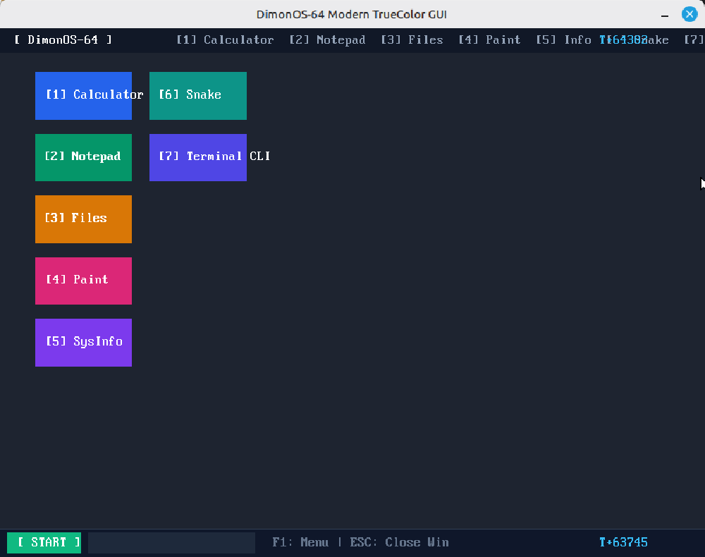
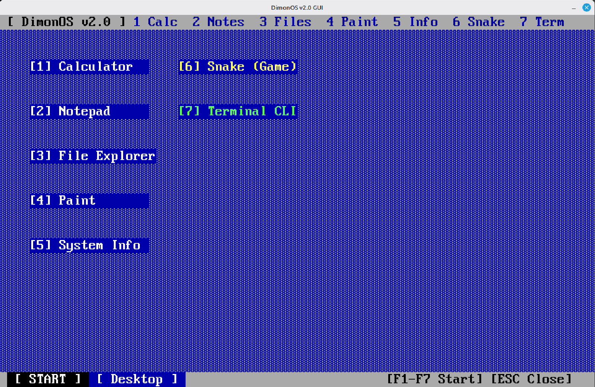

# DimonOS-64 — Native Bare-Metal Multitasking OS

<p align="center">
  
  
</p>

DimonOS-64 has evolved from a virtual machine concept into a **fully native bare-metal operating system**. It features a custom preemptive multitasking kernel, a graphical window manager, and a persistent FAT16 filesystem.

### Key Features
- **Native Bare-Metal Kernel**: Boots via GRUB (Multiboot 1) directly on x86 hardware or emulators (QEMU, VirtualBox).
- **TrueColor GUI**: 800x600 @ 32bpp Linear Framebuffer (LFB) with double-buffering for tear-free rendering.
- **Preemptive Multitasking**: Hardware timer-driven (PIT 1000Hz) round-robin scheduler with native context switching.
- **Hardware Drivers**: PS/2 Keyboard & Mouse, CMOS RTC (Real Time Clock), PC Speaker audio, and ATA PIO disk controller.
- **FAT16 Filesystem**: Full read/write support to persistent ATA disk images.
- **Integrated Apps**: A retained desktop featuring 7 native C applications: Calculator, Notepad (UTF-8), File Explorer, Modern Paint, System Info, Snake, and Terminal CLI.

---

## Build & Run

### Compilation (Linux)

To build the native kernel, FAT16 disk image, and the bootable ISO, use the standard `make` toolchain (requires `gcc-multilib`, `qemu-system-x86`, `grub-pc-bin`, `xorriso`):

```bash
make clean
make all
```
This generates three main artifacts:

* dimon-kernel.elf (The compiled OS kernel)
* dimon-disk.img (The FAT16 data disk with apps and files)
* dimon-baremetal.iso (The bootable CD-ROM image with GRUB)

## Running in QEMU

### To boot the system with persistent FAT16 storage attached, run the following command in your Linux terminal:
```
qemu-system-i386 -cdrom dimon-baremetal.iso -drive file=dimon-disk.img,format=raw,index=0,media=disk,file.locking=off -boot d -m 256M -serial stdio -vga std
```
(Alternatively, you can use the Makefile alias: make run-qemu-persistent or make qemu)
(If the mouse cursor is captured by the QEMU window after startup, release it using Ctrl + Alt + G).

Component,Specification
```
Platform,                    x86 (32-bit kernel, Multiboot compliant)
RAM                          64 MB minimum, dynamically allocated via kernel
Video                        VESA VBE 800x600 TrueColor @ 32bpp (ARGB8888)
Storage                      FAT16 on ATA PIO (LBA28), 512B sectors"
Input                        PS/2 Keyboard (Set 1) and PS/2 Mouse
Audio                        PC Speaker (PIT Channel 2)
Time                         CMOS RTC + PIT (Programmable Interval Timer)
```
## Desktop Controls & Applications

* Mouse & Keyboard: Click [ START ], top-bar shortcuts, and desktop icons. Drag title bars to move windows. Use Alt+Tab to switch windows.
* Notepad: Edits text files directly on the FAT16 disk. Supports Ctrl+S (Save), F3 (Save As), Ctrl+O (Open), and Ctrl+N (New). Safe UTF-8 decoding and overwrite confirmation included.
* File Explorer: Browse the FAT16 disk, view file sizes, and open documents or run .APP binaries.
* Terminal CLI: Run commands like help, info, pwd, ls, clear, and exit.
* System Info: Real-time display of CPU, memory usage, and hardware timer ticks.
* Paint: TrueColor canvas with multiple brush sizes, colors, and an eraser.
* Snake: Playable snake game with score tracking and collision detection.

## Testing & Verification

### The system includes comprehensive automated regression tests utilizing QEMU and the host Python environment.
```
make test               # Runs host-side FAT16 unit tests
make regression         # Runs automated QEMU bare-metal UI/UX integration tests
make kill-qemu          # Kills any hanging background QEMU instances (Linux)

```

